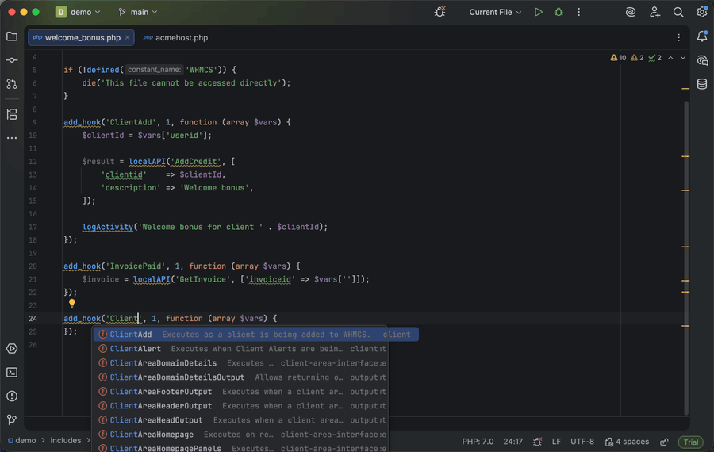
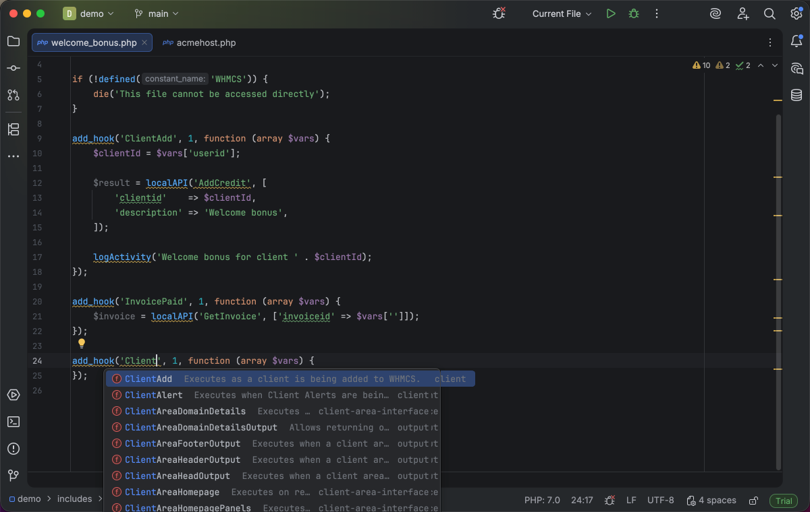
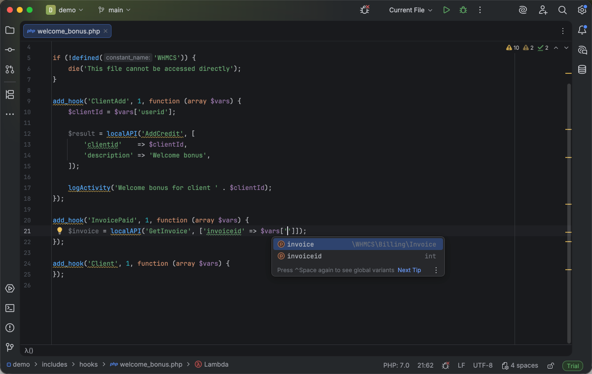
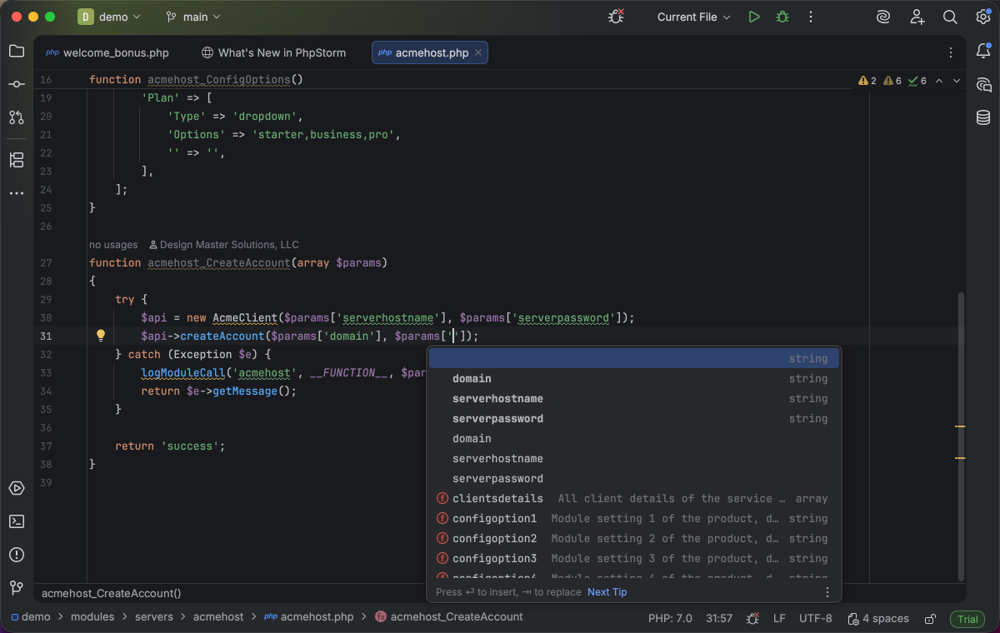
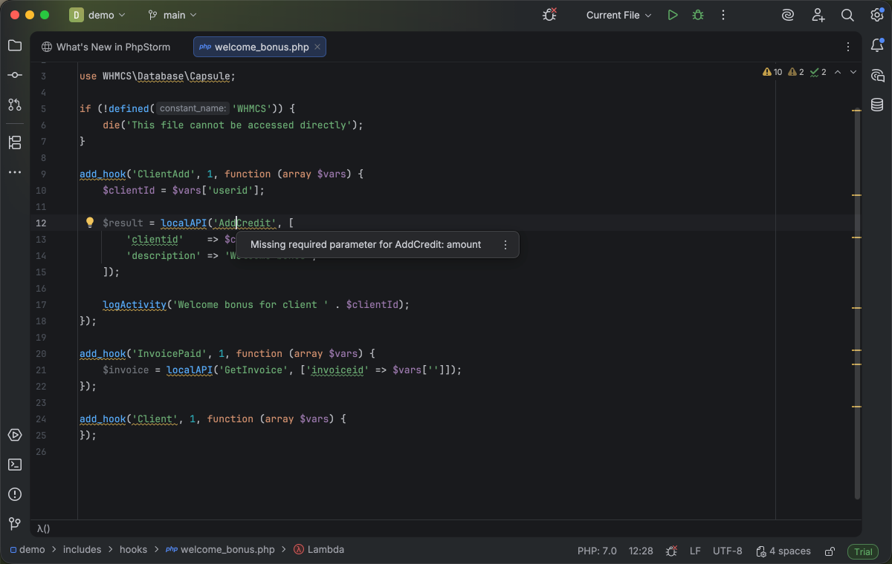
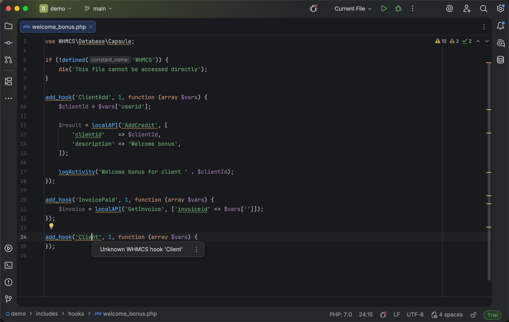
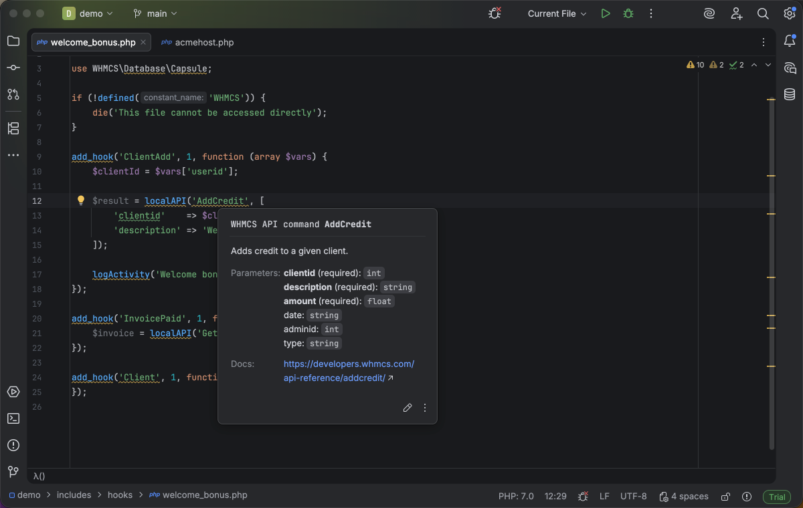

# WHMCS Toolkit for PhpStorm

WHMCS autocomplete (code completion) and typo detection for module and hook development in PhpStorm (and IntelliJ IDEA Ultimate with the PHP plugin).

- Hook names inside `add_hook('...')`: all 334 WHMCS hook points, with what each one does.
- Hook variables: keys of `$vars['...']` inside the hook closure, with their types.
- Internal API: the 162 `localAPI('...')` commands and their request parameters (required ones in bold).
- Module settings: keys of the arrays returned by `mymodule_MetaData()` (DisplayName, APIVersion, RequiresServer...) and `mymodule_ConfigOptions()` (FriendlyName, Type, Options, SimpleMode, Loader...), and the six field types (text, password, yesno, dropdown, radio, textarea).
- Module templates: in `modules/servers/<name>/clientarea.tpl`, and in any `.tpl` a function names with `templatefile`, `{$...}` completes the module parameters (serverip, domain, username...) and the keys of that function's `vars` array. An addon template under `modules/addons/<name>/templates/` completes the `vars` keys returned next to its `templatefile` (the sample `publicpage.tpl` uses `{$modulelink}` and `{$customVariable}` this way) plus the standard client-area theme variables (`WEB_ROOT`, `companyname`, `token`...).
- Payment gateways: `$params` keys in `mygateway_link`, `mygateway_capture`, `mygateway_refund`, `mygateway_storeremote`, `mygateway_remoteinput` and `mygateway_remoteupdate` (invoiceid, amount, returnurl, cardnum, transid, action, gatewayid, paymethodid...) plus the settings of your own `mygateway_config()` (whose keys, FriendlyName/Type System and field types are completed too, and a setting named like a standard parameter such as `currency`, `action` or `paymethodid` is flagged), and the keys of the array capture, refund and storeremote return (status, transid, rawdata, fee, gatewayid...). Remote input and remote update return HTML, so they have no result array. On remoteinput, invoiceid and amount are completed because WHMCS sends them only when the client is paying an invoice.
- Missing required parameters: `localAPI('AddClient', [...])` without `email` only fails at runtime. The plugin lists the required parameters missing from the array.
- Quick Documentation: Ctrl+Q (F1 on macOS) or hover on a hook name or API command shows what it does, its `$vars` or parameters (required ones marked) and a link to the official page.
- Database: `Capsule::table('...')` completes table and column names with their types; worked example in [docs/live-templates.md](docs/live-templates.md#example-query-the-whmcs-database-without-guessing-column-names).
- Typo inspection: a misspelled hook name never fires and WHMCS gives no error. The plugin flags unknown hook names, API commands, misspelled `$vars` keys inside a hook callback, `$params` keys in provisioning functions, and tables and columns in a `Capsule::table()` query, and offers a one-click fix to the closest valid name.
- Live templates: 56 abbreviations (full list and a worked example in [docs/live-templates.md](docs/live-templates.md)). Type `whmodule`, `whaddon`, `whhook` or `whapi` and press Tab for a provisioning module, addon module, hook or localAPI call skeleton, named after the file (e.g. `acmehost.php` gives `acmehost_CreateAccount`).

## Screenshots










## Getting started

1. In PhpStorm, open Settings > Plugins > Marketplace, search for "WHMCS Toolkit" and install it ([plugin page](https://plugins.jetbrains.com/plugin/35775-whmcs-toolkit)). The 30-day trial starts on first use.
2. Open your WHMCS module or hooks folder. Nothing to configure: the plugin works in any PHP file.
3. Try it. In a new empty file, write `<?php` on the first line and press Enter first: the templates only expand inside PHP code, so in a blank file Tab does nothing.

```php
// includes/hooks/welcome.php: type whhook + Tab, then Ctrl+Space inside the quotes
add_hook('ClientAdd', 1, function (array $vars) {
    // Ctrl+Space inside $vars['...'] lists userid, firstname, email...
    $results = localAPI('SendEmail', [
        'messagename' => 'Client Signup Email',
        'id' => $vars['userid'],
    ]);
});
```

- A typo like `add_hook('ClientAddd', ...)` is underlined; Alt+Enter replaces it with `ClientAdd`.
- Add `localAPI('AddClient', ['firstname' => 'Ana']);` inside the closure: the plugin underlines the call and lists the required parameters still missing (`lastname`, `email`, `address1`...), which WHMCS would only report at runtime.
- In `modules/servers/acmehost/acmehost.php`, type `whmodule` + Tab for a full provisioning module named `acmehost_*`.

## Requirements and when nothing shows up

- PhpStorm 2025.3 or newer, or IntelliJ IDEA Ultimate 2025.3+ with the PHP plugin enabled (Settings > Plugins > Installed > PHP). The plugin depends on the PHP plugin and does not load without it.
- The reference data (hooks, `$vars`, localAPI commands, tables) comes from the official WHMCS developer documentation for WHMCS 8.x and 9.x, with the database schema of WHMCS 9.0. It is bundled in the plugin, so everything works offline and no WHMCS install or credentials are needed.
- Completion is contextual, not global. `$vars['...']` completes only inside the closure passed to `add_hook()`, `$params['...']` only inside a function named `<module>_<Function>` (for example `acmehost_CreateAccount`), and hook names only inside the quotes of `add_hook('...')`. Outside those places the IDE falls back to normal PHP completion.
- Press Ctrl+Space inside the quotes or brackets. On macOS that shortcut can be taken by the system input-source switch: change it in System Settings > Keyboard > Keyboard Shortcuts > Input Sources, or use Settings > Keymap > Basic completion in the IDE.
- Still nothing? Confirm the plugin is enabled (Settings > Plugins > Installed > WHMCS Toolkit) and restart the IDE once, then write to contato@designmaster.com.br with the IDE version (Help > About) and the file you were in.

## Trial and license

- The 30-day trial starts on first use and includes every feature; nothing to enter.
- When the trial ends (or a subscription lapses) completion and inspections stop and the IDE shows a license prompt once per session. Your PHP files are never touched, and the plugin collects no data.
- Price: US$ 3.90 per month, or US$ 39 per year (the plugin page shows the current price and your local tax). The first 30 days are free.
- Buy or renew from the [plugin page](https://plugins.jetbrains.com/plugin/35775-whmcs-toolkit); the license is managed by JetBrains (Settings > Plugins > Installed > WHMCS Toolkit shows its state).

## Worked examples

Each one is a complete, copyable result built from a live template. Pick by what you are building:

**Reacting to WHMCS events (hooks)**

- [Do something when an invoice is paid](docs/live-templates.md#example-do-something-when-an-invoice-is-paid)
- [Flag large invoices for review when they are created](docs/live-templates.md#example-flag-large-invoices-for-review-when-they-are-created)
- [Leave a note on the client when an invoice is refunded](docs/live-templates.md#example-leave-a-note-on-the-client-when-an-invoice-is-refunded)
- [Note the client when a late fee is added](docs/live-templates.md#example-note-the-client-when-a-late-fee-is-added)
- [Note the client when money goes out through a gateway](docs/live-templates.md#example-note-the-client-when-money-goes-out-through-a-gateway)
- [Block an order at checkout](docs/live-templates.md#example-block-an-order-at-checkout)
- [Leave a note on the client when an order is accepted](docs/live-templates.md#example-leave-a-note-on-the-client-when-an-order-is-accepted)
- [Warn staff when an order is marked as fraud](docs/live-templates.md#example-warn-staff-when-an-order-is-marked-as-fraud)
- [Tag new clients that need a tax ID](docs/live-templates.md#example-tag-new-clients-that-need-a-tax-id)
- [Record an accepted quote on the client](docs/live-templates.md#example-record-an-accepted-quote-on-the-client)
- [Flag an urgent ticket for staff when it is opened](docs/live-templates.md#example-flag-an-urgent-ticket-for-staff-when-it-is-opened)
- [Raise a ticket's priority when the client replies "urgent"](docs/live-templates.md#example-raise-a-tickets-priority-when-the-client-replies-urgent)
- [A daily job that never breaks the cron](docs/live-templates.md#example-a-daily-job-that-never-breaks-the-cron)
- [Catch a typo before WHMCS silently ignores it](docs/live-templates.md#example-catch-a-typo-before-whmcs-silently-ignores-it)

**Writing modules**

- [A provisioning module in one minute](docs/live-templates.md#example-a-provisioning-module-in-one-minute)
- [Record why a service was suspended](docs/live-templates.md#example-record-why-a-service-was-suspended)
- [Log a service's new package after an upgrade](docs/live-templates.md#example-log-a-services-new-package-after-an-upgrade)
- [Record a password change without ever logging the password](docs/live-templates.md#example-record-a-password-change-without-ever-logging-the-password)
- [Clean up your own data when a service is terminated](docs/live-templates.md#example-clean-up-your-own-data-when-a-service-is-terminated)
- [A domain registrar module in one minute](docs/live-templates.md#example-a-domain-registrar-module-in-one-minute)
- [Log every domain your registrar module registers](docs/live-templates.md#example-log-every-domain-your-registrar-module-registers)
- [A payment gateway in two files](docs/live-templates.md#example-a-payment-gateway-in-two-files)
- [An addon module with an admin page](docs/live-templates.md#example-an-addon-module-with-an-admin-page)

**Client area and database**

- [Show a custom value in the client area](docs/live-templates.md#example-show-a-custom-value-in-the-client-area)
- [Query the WHMCS database without guessing column names](docs/live-templates.md#example-query-the-whmcs-database-without-guessing-column-names)

Paid plugin with a 30-day free trial, sold through JetBrains Marketplace.

Support and bug reports: open an issue in this repository or write to contato@designmaster.com.br.

License: [EULA](EULA.md). Privacy: [the plugin collects no data](PRIVACY.md).

Made by [Design Master](https://www.designmaster.com.br/?utm_source=github.com&utm_medium=referral&utm_campaign=whmcs-toolkit), a WHMCS hosting company in Brazil.
